# Evidencias de ejecución

Capturas de las ejecuciones reales del proyecto, tomadas el **9 de noviembre de 2026 a las 17:30 (hora del centro de México)**
en un entorno local: Node.js 22, PostgreSQL 16 y k6 v0.54.0.
Las capturas se presentan en una ventana de **Windows PowerShell** con la ruta del proyecto
`C:\Users\zayda\Documents\ING 10 Cuatri\TACHO (app moviles)\ejercicio-tester`.
Cada imagen muestra en la primera línea el comando y debajo la salida real que produjo.
Las salidas en texto completo están en `evidencia/`.

> Todas las cuentas son sintéticas (`@example.test`). En ninguna captura aparecen tokens ni contraseñas reales.

## Índice

| # | Captura | Ejercicio |
|---|---|---|
| 1 | [Suite completa + cobertura](#1-suite-completa-7979-y-cobertura) | 14 |
| 2 | [Pruebas unitarias](#2-pruebas-unitarias) | 4, 8 |
| 3 | [Pruebas de API](#3-pruebas-de-api) | 2, 6 |
| 4 | [Seguridad](#4-seguridad-básica) | 9 |
| 5 | [Humo, mock e integración](#5-humo-mock-e-integración) | 13, 15 |
| 6 | [Código roto a propósito](#6-ejercicio-14-código-roto-a-propósito) | 14 |
| 7 | [Código restaurado](#7-ejercicio-14-código-restaurado) | 14 |
| 8 | [API corriendo](#8-api-corriendo) | — |
| 9 | [k6: umbral original](#9-k6-umbral-original) | 10 |
| 10 | [k6: umbral cambiado](#10-k6-umbral-cambiado) | 10 |
| 11 | [k6: lista de tareas](#11-k6-lista-de-tareas-autenticada) | 10 |
| 12 | [Sesión exploratoria](#12-sesión-exploratoria) | 3 |
| 13 | [Estructura del proyecto](#13-estructura-del-proyecto) | — |

---

### 1. Suite completa (79/79) y cobertura
Las 7 suites pasan; la cobertura de líneas es del 92 %.

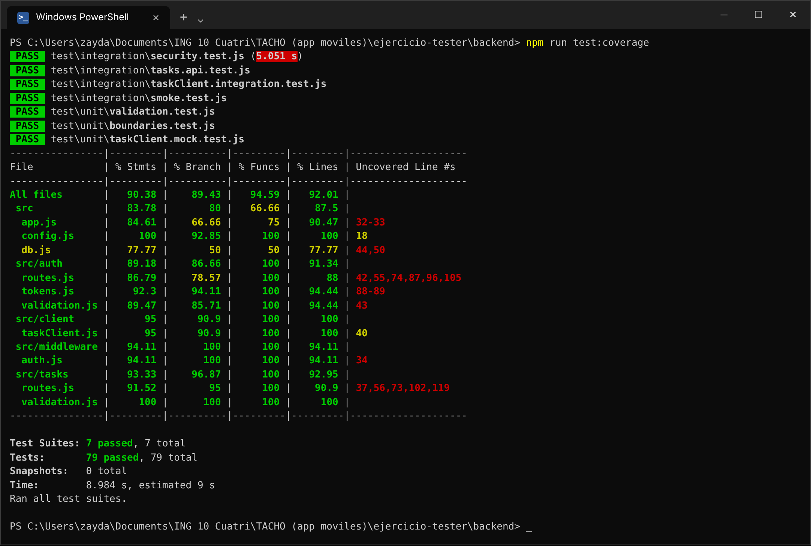

### 2. Pruebas unitarias
Título en el máximo (120), id ausente y la tabla de valores límite de título y contraseña.

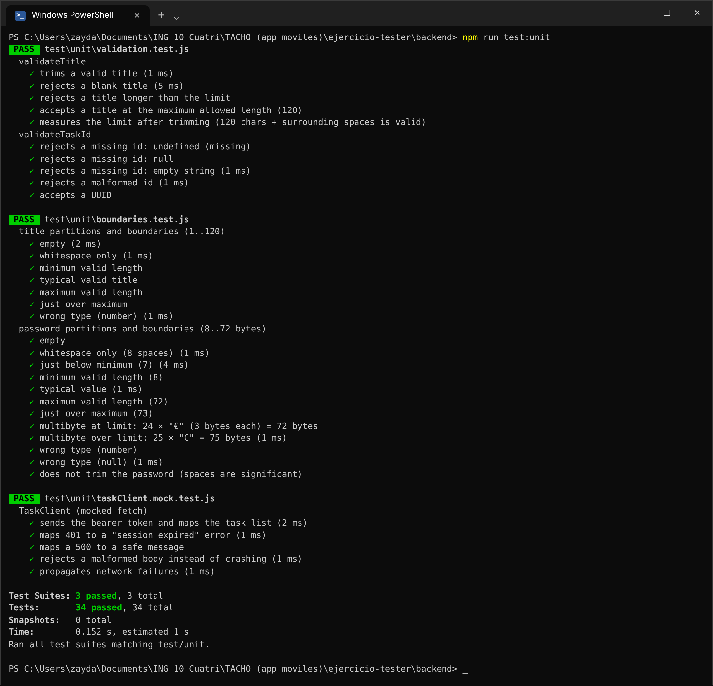

### 3. Pruebas de API
Id inválido, título ausente, intento de actualizar o borrar una tarea ajena, y la regresión del bug BUG-TM-042.

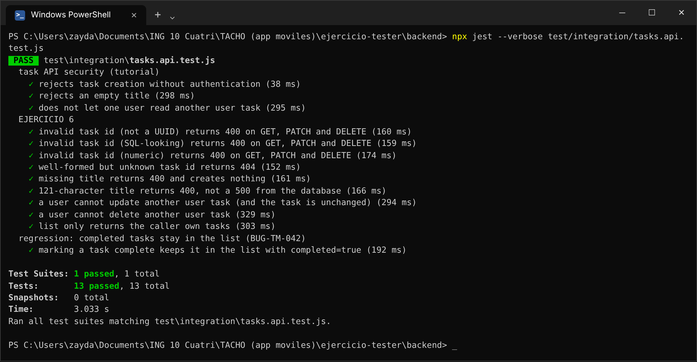

### 4. Seguridad básica
`ownerId` ignorado, entradas con aspecto de inyección SQL o HTML, tokens expirados o falsificados, rotación de refresh tokens con detección de reutilización, logout-all y rate limit.

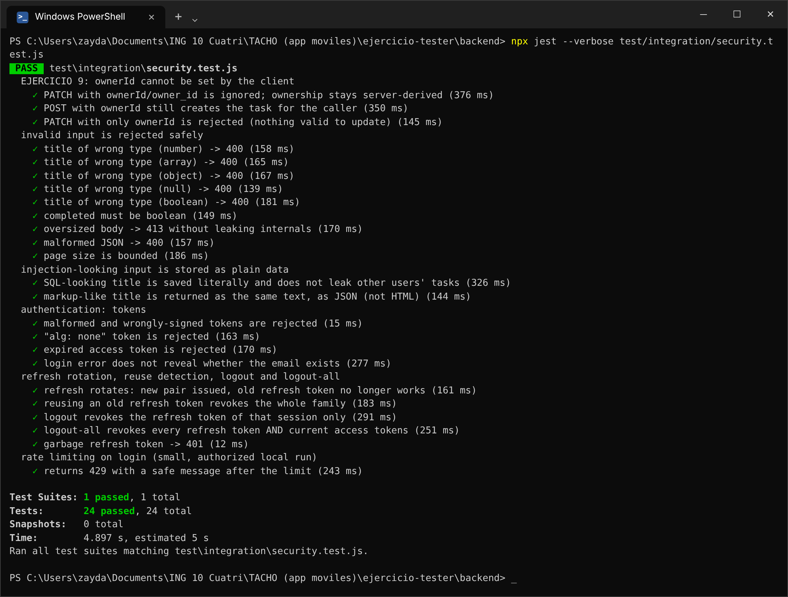

### 5. Humo, mock e integración
La suite de humo y el mismo cliente probado de dos formas: con un mock y contra la API real.

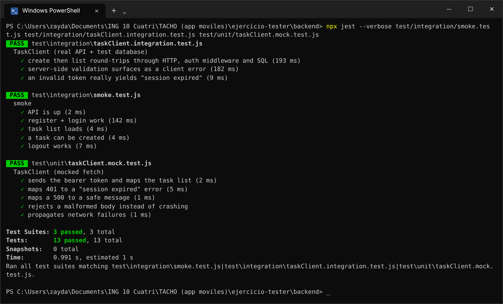

### 6. Ejercicio 14: código roto a propósito
Con `TITLE_MAX = 200` fallan 3 pruebas. La prueba de API muestra que el usuario recibía un **500** en lugar de un 400.

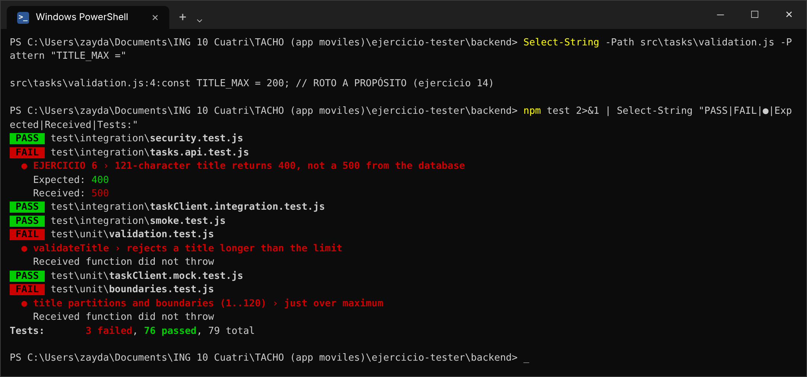

### 7. Ejercicio 14: código restaurado
Con el límite de vuelta en 120, todo pasa otra vez.

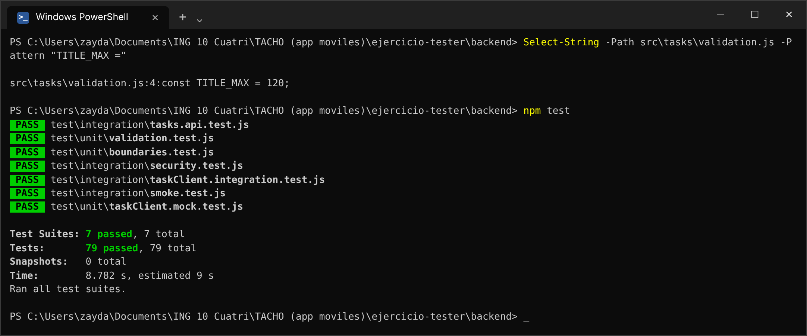

### 8. API corriendo
`/health` responde 200 con las cabeceras de seguridad de `helmet`, y `/tasks` sin token responde 401.

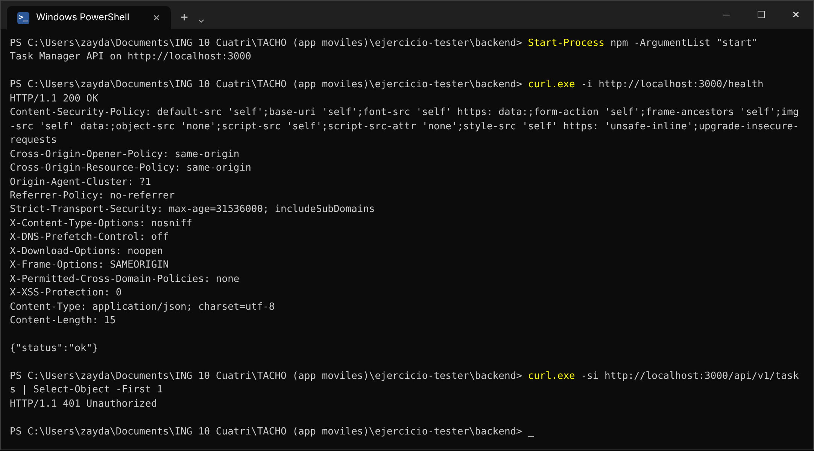

### 9. k6: umbral original
Umbral `p(95) < 500 ms`: la prueba pasa, con 0 % de errores.

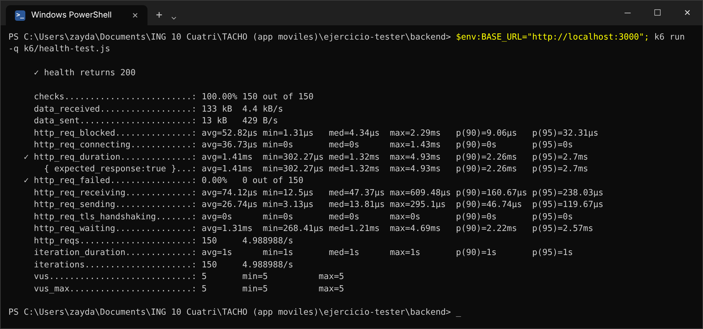

### 10. k6: umbral cambiado
Con `p(95) < 1 ms` el umbral se cruza ✗ y k6 sale con **código 99**, aunque el servicio respondió bien el 100 % de las peticiones.

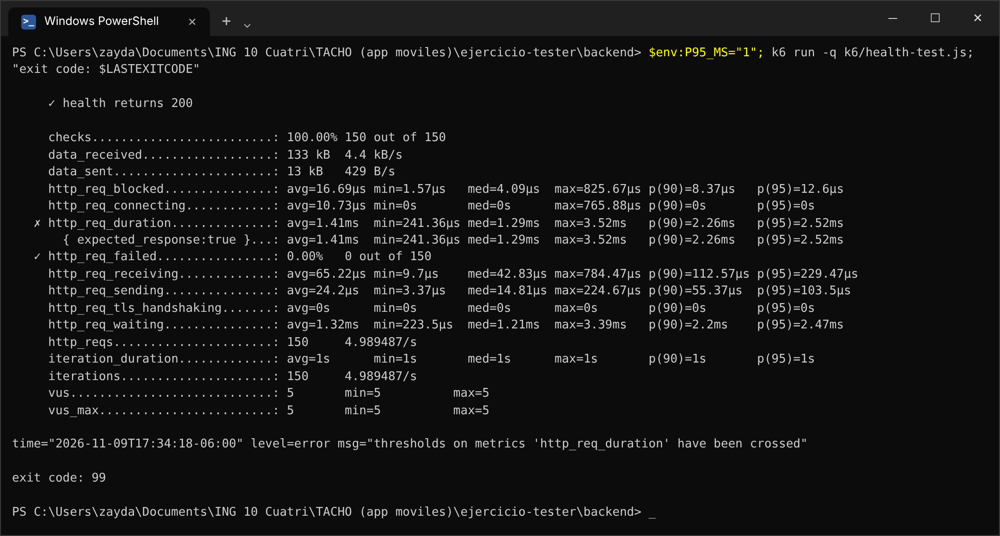

### 11. k6: lista de tareas autenticada
`GET /tasks` con JWT y PostgreSQL, 20 tareas por petición.

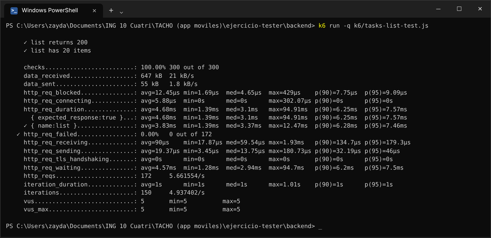

### 12. Sesión exploratoria
Hallazgos reproducidos en vivo:
- 61 emoji se rechazan (BUG-TM-044).
- Se acepta un título de ancho cero (BUG-TM-043).
- 5 envíos rápidos crean 5 duplicados (BUG-TM-045).
- Editar con el servidor caído no deja datos a medias.

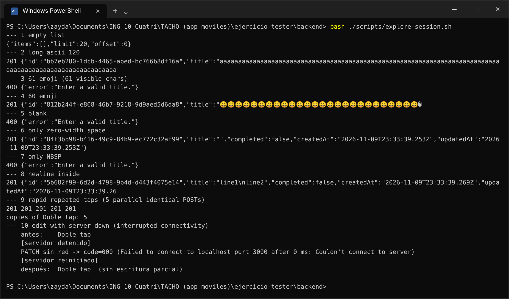

### 13. Estructura del proyecto

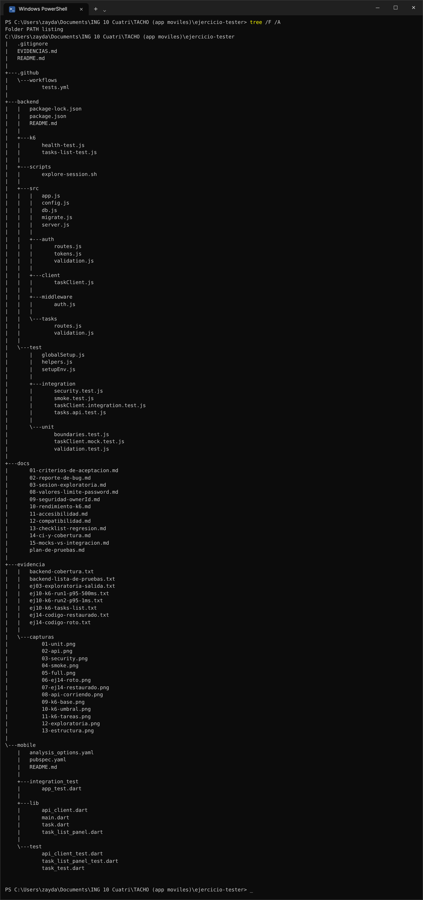

---

## Lo que no tiene captura

La parte **Flutter** (ejercicios 4, 5 y 7 del lado móvil, y el apoyo a los ejercicios 11 y 12) está escrita, pero no se pudo
ejecutar: en el entorno de trabajo no había SDK de Flutter ni emulador. Para completar la evidencia,
ejecuta `flutter test` y la prueba de integración siguiendo `mobile/README.md`, y agrega aquí tus capturas,
por ejemplo en `evidencia/capturas/14-flutter-test.png`.

## Archivos de texto de respaldo

| Archivo | Contenido |
|---|---|
| `evidencia/backend-lista-de-pruebas.txt` | Las 79 pruebas, con el tiempo de cada una |
| `evidencia/backend-cobertura.txt` | Tabla de cobertura |
| `evidencia/ej03-exploratoria-salida.txt` | Sesión exploratoria original |
| `evidencia/ej10-k6-*.txt` | Salidas completas de k6 |
| `evidencia/ej14-codigo-roto.txt` / `ej14-codigo-restaurado.txt` | Experimento de CI |
