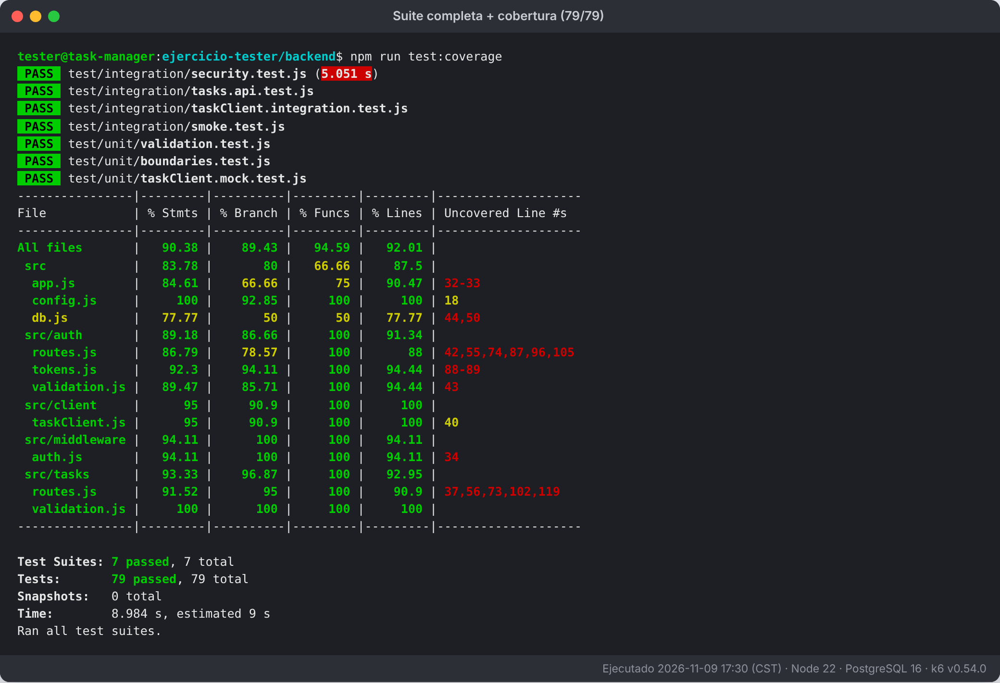

# Ejercicios resueltos – "Become a Better Application Tester"

Solución de los 15 ejercicios prácticos del tutorial sobre un Task Manager real:
API **Node.js/Express + PostgreSQL + JWT con refresh tokens** y app **Flutter**.

## Resultado

| | |
|---|---|
| Backend | **79/79 pruebas en verde** (unitarias, API, seguridad, humo) · cobertura de líneas 92 % |
| k6 | 3 corridas reales contra la API local (una falla a propósito al endurecer el umbral) |
| Exploratoria | Sesión real de 15 min contra la API → **3 bugs nuevos** encontrados |
| Flutter | Código y pruebas escritos; **no ejecutados** (no había SDK de Flutter en el entorno donde se hizo) |
| Accesibilidad / dispositivos | Revisión de código + pruebas automatizadas + hojas listas para hacerlo en el teléfono |

## Evidencias

📸 **[EVIDENCIAS.md](EVIDENCIAS.md)**: 13 capturas de las ejecuciones reales (pruebas, cobertura, experimento del ejercicio 14, k6 y sesión exploratoria).



## Dónde está cada ejercicio

| # | Ejercicio | Entregable |
|---|---|---|
| 1 | Tres criterios de aceptación (éxito, inválido, permisos) | `docs/01-criterios-de-aceptacion.md` |
| 2 | Bug: tarea desaparece al completarla | `docs/02-reporte-de-bug.md` + prueba de regresión en `backend/test/integration/tasks.api.test.js` |
| 3 | Exploración de 15 min (título largo, vacío, taps rápidos, sin red) | `docs/03-sesion-exploratoria.md` · `evidencia/ej03-*` · `backend/scripts/explore-session.sh` |
| 4 | Unit test: id ausente y título en el máximo | `backend/test/unit/validation.test.js` · `mobile/test/task_test.dart` |
| 5 | Botón Retry que llama al callback exactamente una vez | `mobile/lib/task_list_panel.dart` · `mobile/test/task_list_panel_test.dart` |
| 6 | API: id inválido, título ausente, actualizar tarea ajena | `backend/test/integration/tasks.api.test.js` |
| 7 | E2E: completar tarea, cerrar sesión, ver login | `mobile/integration_test/app_test.dart` |
| 8 | Valores límite del campo contraseña | `docs/08-valores-limite-password.md` · `backend/test/unit/boundaries.test.js` |
| 9 | Actualizar tarea con `ownerId` (+ seguridad básica) | `docs/09-seguridad-ownerId.md` · `backend/test/integration/security.test.js` |
| 10 | k6: correr, cambiar un umbral, explicar | `docs/10-rendimiento-k6.md` · `backend/k6/` · `evidencia/ej10-*` |
| 11 | Lector de pantalla + texto grande | `docs/11-accesibilidad.md` |
| 12 | Pantalla pequeña vs. grande | `docs/12-compatibilidad.md` |
| 13 | Checklist de regresión (crear, editar, completar, borrar, acceso cruzado) | `docs/13-checklist-regresion.md` · `backend/test/integration/smoke.test.js` |
| 14 | CI que falla al romper el comportamiento | `.github/workflows/tests.yml` · `docs/14-ci-y-cobertura.md` · `evidencia/ej14-*` |
| 15 | Mock vs. integración (+ prueba inestable corregida) | `docs/15-mocks-vs-integracion.md` · `backend/test/unit/taskClient.mock.test.js` · `backend/test/integration/taskClient.integration.test.js` |
| — | Plan de pruebas (plantilla del tutorial, llena) | `docs/plan-de-pruebas.md` |

## Hallazgos que vale la pena leer

1. **Ej. 14:** con la validación rota, la API devolvía **500** (no 400) porque ninguna prueba de API enviaba
   121 caracteres; la cobertura era del 100 % en esa línea igualmente. Se añadió la prueba.
2. **Ej. 3:** se pueden crear tareas **invisibles** (`​`), los **emoji cuentan doble** en el límite
   de 120, y 5 envíos rápidos crean **5 duplicados**.
3. **Ej. 15:** 6 pruebas fallaban por un **rate limiter compartido** entre pruebas; se corrigió aislando
   el estado, no reintentando.

## Cómo ejecutarlo

```bash
# Backend (requiere PostgreSQL)
cd backend && npm ci
createdb taskmanager_test
npm test

# Flutter
cd mobile && flutter create . --project-name my_app && flutter pub get && flutter test
```

Detalles en `backend/README.md` y `mobile/README.md`.

Todo usa datos sintéticos y solo entornos locales; no hay tokens ni contraseñas reales en ningún archivo.
